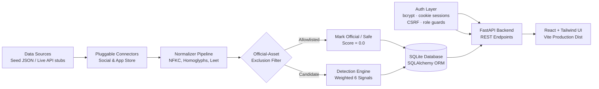

# ImpostorRadar 🛡️📡

> **Digital Risk Protection Platform — Social Media & App Store Monitoring**  
> *Built for the Kampus.VC 24-Hour Hackathon Challenge*

[](https://www.python.org/)
[](https://fastapi.tiangolo.com/)
[](https://react.dev/)
[](https://vitejs.dev/)
[](https://tailwindcss.com/)
[](backend/tests/)

**ImpostorRadar** is a specialized Digital Risk Protection (DRP) platform engineered exclusively for **Social Media and App Store Impersonation Monitoring**. It identifies brand copycats, phishing profiles, deceptive loan applications, and typosquatting scams with explainable multi-signal scoring and generates 1-click legal takedown packs.

In production, **FastAPI serves the compiled React SPA directly**, providing **ONE unified deployable service** — with a complete authentication and role-based access layer in front of every API endpoint.

> **Data honesty:** today the platform scans **bundled sample data locally** — no live social/app-store API is connected and there is no continuous monitoring. See [`docs/data_sources.md`](docs/data_sources.md) for exactly what is real vs. simulated.

---

## 🌟 Unique Differentiating Features

1. **Explainable Threat Cards**: Every detection displays a visual side-by-side logo comparison, 64-bit perceptual hash (pHash) match indicator, 6-signal breakdown bar chart, and human-readable forensic reasons.
2. **Look-alike Lab**: Analysts type any brand name to instantly generate variants (character swaps, Cyrillic homoglyphs, leetspeak, spacing, bait keywords) and see in real time which variants match active monitored threat feeds.
3. **One-Click Takedown Pack**: Instantly generates platform-specific legal complaints (Twitter/X, Meta, Google Play, Apple App Store, Telegram) and an executive ReportLab PDF evidence dossier with forensic logs and digital signature blocks.
4. **Trust Radar Dashboard**: Live organizational **Brand Exposure Score** (0–100 risk index), cross-channel threat distributions, and look-alike technique frequencies powered by Recharts.
5. **Zero False-Positive Invariant**: Strict official asset allowlist filtering excludes official handles and package IDs *before* threat scoring.
6. **Graceful Fault-Tolerant Connectors**: Pluggable connectors with live API stubs and sample fallbacks. If upstream sources go offline, the UI shows a friendly cached data banner—scans *never* crash.
7. **Secure Multi-User Access**: Signup/login/logout with bcrypt-hashed passwords, httpOnly cookie sessions, CSRF protection, and three roles (Administrator / Analyst / Viewer) enforced on the backend.

---

## 📐 Architecture



---

## 🔐 Authentication & Roles

- **Signup / Login / Logout** with bcrypt (cost 12) password hashing — no plaintext passwords anywhere.
- **Session cookies**: `ir_session` (httpOnly, SameSite=Lax, expires after `SESSION_HOURS`, default 12h) + `ir_csrf` for CSRF double-submit protection on every state-changing request. No tokens in `localStorage`.
- **First account becomes the Administrator**; later self-registrations receive the Analyst role (self-signup can never grant admin). Password policy: ≥10 chars, not all digits/letters, different from email.
- **All `/api` endpoints are authenticated**; role restrictions are enforced server-side — hiding UI buttons is just convenience, not the security boundary.

| Capability | Viewer | Analyst | Administrator |
| :--- | :---: | :---: | :---: |
| View dashboard, brand, detections, dossiers | ✅ | ✅ | ✅ |
| Run scans · edit brand · takedown packs · delete single detection | — | ✅ | ✅ |
| Delete detection history · manage sources · manage users · view audit log | — | — | ✅ |

- **Security audit log**: signup, login, failed logins, logout, role changes, deletions, and source toggles are recorded and visible to administrators.
- The **last active administrator cannot be demoted or disabled**.
- This single-brand deployment uses a **shared workspace model** (all authorized users see the same brand) — accounts and sessions are still strictly personal.

---

## ⚖️ Multi-Signal Scoring Engine (0–100 Scale)

$$\text{Threat Score} = \sum_{i=1}^{6} w_i \cdot s_i$$

| Signal | Weight | Method |
| :--- | :---: | :--- |
| **Name Similarity** | **35** | RapidFuzz token/lexical ratio; common compounds (e.g. *Paytm Valley Farms*) are discounted to prevent over-flagging |
| **Look-alike Technique** | **15** | Detection of swaps, Cyrillic homoglyphs (`а`), leetspeak (`0`, `1`, `rn`), spacing (`Pay tm`), added bait words (`official`, `care`, `kyc`) |
| **Logo Perceptual Hash** | **20** | 64-bit image perceptual hash (`imagehash.phash`) Hamming distance |
| **Bio / Description Similarity** | **10** | Scikit-learn TF-IDF Vectorizer cosine similarity against brand keywords |
| **Publisher / Dev Mismatch** | **10** | For apps: unverified publisher; for social: unverified account claiming official support role |
| **Scam / Phishing Indicators** | **10** | Phishing triggers (*DM to claim*, *instant loan*, *urgent KYC*, *bit.ly*, *enter OTP*), combined with account age and follower count heuristics |

**Verdict Bands:**  
- **High Threat**: $\ge 75$ (Immediate takedown)
- **Medium Threat**: $50 - 74$ (Suspicious look-alike / reseller)
- **Low Threat**: $30 - 49$ (Weak resemblance / borderline mention)
- **Safe**: $< 30$ (Legitimate business / official verified asset)

---

## 🚀 Quickstart & Local Setup (Windows PowerShell)

### Prerequisites
- Python 3.11+
- Node.js 18+ and npm

### 1. Set Up Backend

```powershell
# From project root
cd backend
python -m venv .venv
.\.venv\Scripts\Activate.ps1

pip install -r requirements.txt
cd ..
```

### 2. Configure Environment (optional — dev defaults work)

```powershell
Copy-Item .env.example .env
```

`.env.example` documents every setting (database path, CORS origins, session hours, signup policy, optional first-admin bootstrap). Never commit a real `.env`.

### 3. Build Frontend

```powershell
cd frontend
npm install
npm run build
cd ..
```

### 4. Run the Unified Production Service

FastAPI serves the API endpoints *and* the built React app from `frontend/dist` on a single port:

```powershell
# From project root
backend\.venv\Scripts\uvicorn app.main:app --app-dir backend --host 127.0.0.1 --port 8000
```

Open your browser at **`http://127.0.0.1:8000`** → you land on the **login page**.

- **First visit:** click *Create one* — the **first account becomes the Administrator**.
- The very first startup pre-seeds the demo brand "Paytm" and one scan so the dashboard shows live data immediately. On every later restart, existing data is preserved — **startup never resets the database**.

For frontend hot-reload development, run `npm run dev` inside `frontend/` (proxies `/api` and `/uploads` to `127.0.0.1:8000`).

---

## 🧪 Running Automated Tests

```powershell
# From the backend directory
cd backend
.\.venv\Scripts\python.exe -m pytest -q
```

**Latest result:**
```text
62 passed, 3 warnings in 32s
```

Coverage includes: signup success/duplicate/validation, login success/invalid/expired sessions, logout session invalidation, unauthenticated access rejection on every protected endpoint, role restrictions (viewer/analyst/admin), unauthorized delete-history attempts, authorized deletion with confirmation + rollback, data persistence across restarts, brands/official-assets surviving history deletion, user-to-user & IDOR protections, unavailable-connector resilience, source-status accuracy on listings, oversized-ID rejection (no 500s), upload sandbox headers, official-asset exclusion (never flagged), look-alike detection (swaps/spacing/punctuation/homoglyphs/leetspeak/added words), innocent-compound false-positive prevention, takedown pack outputs, and detection-engine consistency.

Frontend production build: `cd frontend && npm run build` → ✅ 2519 modules transformed.

---

## 💾 Data Retention & Safe Deletion

- Scans **add/update** data; restart, logout, page changes, and brand switching **never delete** anything.
- "Delete Detection History" is **Administrator-only**, requires typing the exact confirmation phrase `DELETE_DETECTION_HISTORY` in a dialog that lists what will/won't be deleted, offers an optional **backup first** (JSON export + full SQLite copy into `backend/backups/`), runs inside a **single transaction with rollback**, verifies brand/assets are untouched afterwards, and writes an audit entry.
- Brand profile, official assets, uploaded logos, users, and audit logs are **never** affected by history deletion.

---

## ☁️ Deployment

### Render Deployment (`render.yaml`)

The repository includes a ready `render.yaml` for deploying as a single Web Service:

- **Build Command**: `cd frontend && npm install && npm run build && cd ../backend && pip install -r requirements.txt`
- **Start Command**: `uvicorn app.main:app --host 0.0.0.0 --port $PORT --app-dir backend`
- **Persistence**: SQLite DB, uploads, and backups live on a mounted disk (`/var/data`) — configure it per `render.yaml` (Render disks require a paid instance type). On free tiers without a disk, data is **ephemeral**: it is lost on redeploy. Use `DATABASE_URL`, `UPLOAD_DIR`, and `BACKUP_DIR` env vars to point at persistent storage.

---

## 📁 Repository Structure

```
.
├── backend/
│   ├── app/
│   │   ├── main.py                  # FastAPI app, security middleware, SPA hosting
│   │   ├── config.py                # Env-driven settings (DB, CORS, sessions, paths)
│   │   ├── db.py                    # Engine/session, init_db, admin bootstrap
│   │   ├── models.py                # users, auth_sessions, audit_logs, brands, official_assets, scan_runs, detections
│   │   ├── schemas.py               # Pydantic schemas & validators
│   │   ├── security.py              # bcrypt, sessions, CSRF, role guards, audit writer
│   │   ├── connectors/              # Ingestion connectors (social, appstore, live stubs)
│   │   ├── data/                    # Seed candidates JSON & common words
│   │   ├── routers/                 # auth, users, audit, brand, social, apps, detections,
│   │   │                            # lookalike, takedown, dashboard, sources, health
│   │   └── services/                # Detection, scoring, imagesim, lookalike, takedown
│   ├── tests/                       # Pytest suite (auth, api, detection, retention, smoke)
│   ├── uploads/                     # Brand logos & candidate images (served auth-only)
│   ├── backups/                     # Pre-deletion DB backups & JSON exports
│   └── requirements.txt
├── frontend/
│   ├── src/
│   │   ├── api/client.js            # API client: credentials, CSRF header, 401 handling
│   │   ├── auth/AuthContext.jsx     # Session state + permission helper
│   │   ├── components/              # ThreatCard, SeverityBadge, SourceBanner, ConfirmDialog,
│   │   │                            # AccessDenied, UserMenu
│   │   ├── pages/                   # Login, Signup, Dashboard, Brand, Social, Apps,
│   │   │                            # Lab, DetectionDetail, Settings, Users
│   │   ├── App.jsx                  # Routing, role-aware navigation
│   │   └── main.jsx                 # Entry point
│   └── package.json
├── docs/
│   ├── project_explanation.md       # Beginner-friendly full explanation
│   ├── data_sources.md              # Real vs simulated data, integration guide
│   ├── architecture.md              # In-depth system architecture & formulas
│   └── pitch_and_demo.md            # Slide outline & judge demo script
├── .env.example                     # Documented configuration template (placeholders only)
├── .gitignore                       # Excludes .env, local DBs, backups, private uploads
├── render.yaml                      # Single-service Render deployment spec
└── README.md
```

---

## 👥 Hackathon Challenge Alignment

- **Only Social & App Monitoring**: 100% focused on social handles and mobile app stores.
- **Fast 10-Second Judge Demo**: "Load Demo Brand" pre-fills official assets and auto-runs scans.
- **Resilient**: Source outage simulation toggle proves scans never crash.
- **Explainable & Actionable**: Every score has human-readable evidence reasons and instant PDF takedown generation.
- **Secure by Default**: Real login, three roles, CSRF-protected cookie sessions, admin-only destructive actions, full audit trail.
